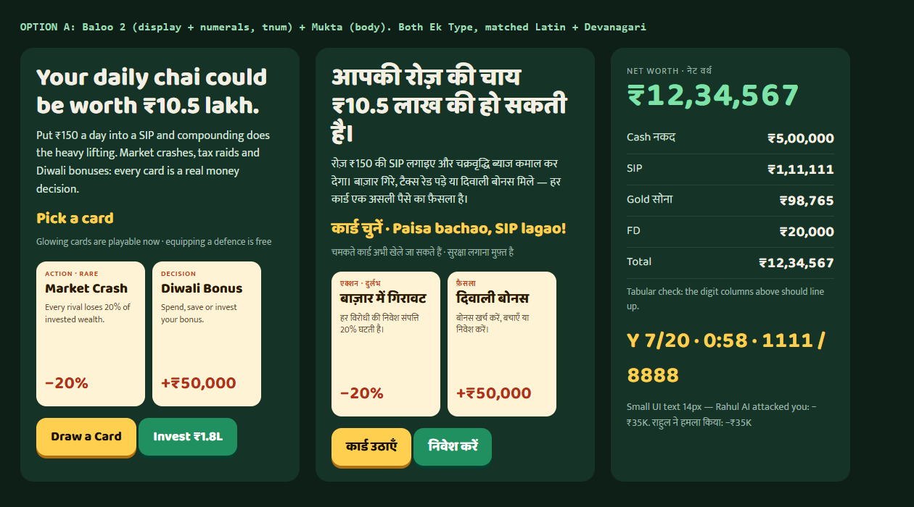
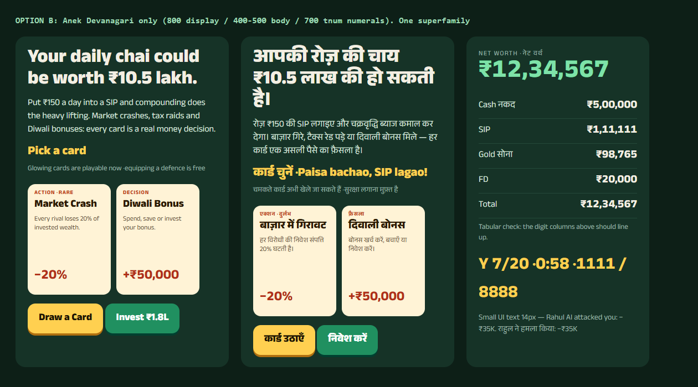
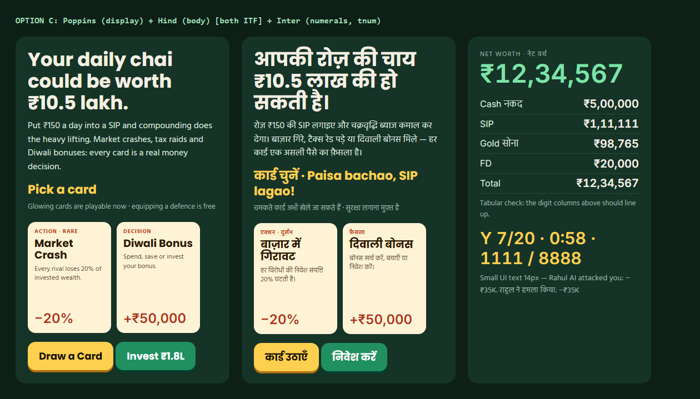
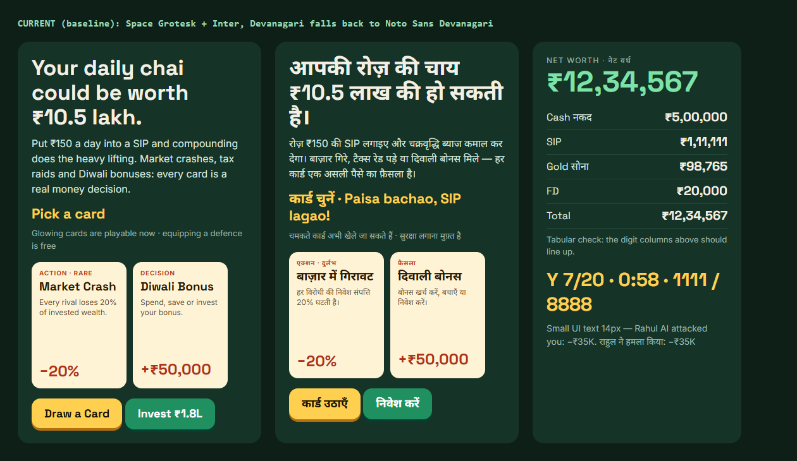

# BHAO UI/UX Research (Agent 1 → Agent 2)

Date: 2026-10-13 · Author: Agent 1 (UI/UX Researcher) · Scope: whole app (web PWA + Android/Capacitor), EN / हिंदी / Hinglish

Screenshots: `docs/ux/current/` (prefix `p-` = phone portrait 390×844, `l-` = phone landscape 844×390, `d-` = desktop 1366×768, `-hi` = Hindi). Font specimens: `docs/ux/fonts/`.

---

## 0. Executive summary

1. **There is no single visual system.** At least 5 different "apps" coexist: cream/mint glass menus (Landing, Guest home, Library), white/emerald Tailwind (Auth, Campaign), mint card-stack (Practice setup), dark green/navy "felt" with raster gold frames (Game board), and a navy/Sora palette (Lobby code). 989 inline `style={{}}` blocks, 169 `!important`, **314 unique hex colours** in `src/`.
2. **Fonts are broken, not just "not nice".** The CSS stack starts with `'Outfit'` (never loaded) → body actually renders in Inter. Card titles and the match timer use `'Avengenz'` (no `@font-face`, no file anywhere — it is **not loaded**; it silently falls back to the system `sans-serif`, i.e. Arial on Windows / Roboto on Android). Lobby uses `'Sora'` and `'Clash Display Variable'` (never loaded). Auth imports Playfair Display from a second Google Fonts CDN. All "real" fonts come from the Google Fonts CDN → **the Android app is not offline-safe** and Hindi falls back to whatever Devanagari the phone has.
3. **Hindi is a second-class citizen visually**: there is a blunt `html.lang-hi` override (`index.css:1046-1055` kills uppercase/letter-spacing and sets heading line-height 1.35) but body line-height stays 1.5, Devanagari falls back to an unmatched Noto, and there is baked-in English in images/labels ("EXIT", "GAME LOG", "LEVEL - 1", "OPPORTUNITY", English quotes on the Hindi outcome card, level names "Brahmacharya" in Latin script in Hindi mode).
4. **The game board on a phone wastes ~40% of the screen** while cards are cropped: only ~2.3 of 5 hand cards are visible (horizontal scroll), card names truncate ("FIRE Movement..", "Market Correcti..."), every card shows the **same purple wallet art**, and the card's text is 8–11 px.
5. **Two clocks and a hidden ticker**: a 19:57 match timer and a 58 s turn timer sit side by side, the log ticker is truncated to "Ga..." and the wallet/net worth needs a dropdown. The player cannot see at a glance *"what do I do now, how am I doing vs. rivals, how much time do I have"*.
6. **Tone drifts toward gambling**: green felt + gold coins + "$" coins on the setup screen + "Earn. Attack. Dominate." + "BETTER LUCK NEXT TIME" + "Entry Reward +100 DC". For a 13+ money-literacy game in India (where Teen Patti / Rummy apps use exactly this vocabulary), this is the single biggest brand risk.
7. **What already works** (keep): the decision sheet's Spend / Save / Invest colour coding with consequence hints, the tutorial's "₹150 chai → ₹10.5 lakh" hook, the Gyaan Library concept sheets, level-intro "The one idea", the money report card ("Inflation's Favourite Customer") and the outcome cards. These are the soul of the product; the redesign should *amplify* them.
8. **Competitor lesson in one line**: Clash Royale / Marvel Snap for the board (thumb-zone hand at the bottom, ultra-readable cards, progressive disclosure), Duolingo for the meta (one obvious next action, chunky 3D buttons, mascot, celebratory feedback, path map), Groww / Jar for money trust (calm, numbers-first, no jargon, Indian formatting), Balatro for juice (number roll-ups, layered feedback).
9. **Recommended visual direction: "Chai & Chips — warm Indian money table"** (Direction 1, §6): warm cream "paper" for menus and cards, a deep teal-green table only inside matches, haldi-yellow primary buttons, with strict semantic colours Spend = terracotta, Save = green, Invest = indigo-blue, Risk = amber, Defence = teal. Duolingo-style chunky buttons, Groww-style calm numbers.
10. **Recommended fonts: Option A — Baloo 2 (display + ₹ numerals with `tnum`) + Mukta (body/UI)**, both Ek Type families with matched Latin + Devanagari, OFL, self-hosted woff2 (~390 KB for all needed weights, both scripts). Option B (Anek Devanagari one-family) is a strong, more compact/"premium" alternative. Specimens in `docs/ux/fonts/`.

---

## 1. Current-state audit

### 1.1 Screens captured

| Screen | Phone portrait | Phone landscape | Desktop | Hindi |
|---|---|---|---|---|
| Landing | [p-01](current/p-01-landing.jpg), [full](current/p-01-landing-full.jpg) | [l-01](current/l-01-landing.jpg) | [d-01](current/d-01-landing.jpg), [full](current/d-01-landing-full.jpg) | [p-hi-01](current/p-hi-01-landing.jpg) |
| Auth | [p-02](current/p-02-auth.jpg) | [l-02](current/l-02-auth.jpg) | [d-02](current/d-02-auth.jpg) | [p-hi-02](current/p-hi-02-auth.jpg) |
| Legal (Privacy) | [p-03](current/p-03-legal.jpg) | [l-03](current/l-03-legal.jpg) | [d-03](current/d-03-legal.jpg) | |
| Guest home (dashboard for guests) | [p-04](current/p-04-guest-home.jpg) | [l-04](current/l-04-guest-home.jpg) | [d-04](current/d-04-guest-home.jpg) | [p-hi-04](current/p-hi-04-guest-home.jpg) |
| Multiplayer (guest → sign-in wall) | [p-05](current/p-05-multiplayer-guest.jpg) | [l-05](current/l-05-multiplayer-guest.jpg) | [d-05](current/d-05-multiplayer-guest.jpg) | |
| Campaign map | [p-06](current/p-06-campaign.jpg), [full](current/p-06-campaign-full.jpg) | [l-06](current/l-06-campaign.jpg) | [d-06](current/d-06-campaign.jpg) | [p-hi-06](current/p-hi-06-campaign.jpg) |
| Level intro sheet | [p-07](current/p-07-level-intro.jpg) | [l-07](current/l-07-level-intro.jpg) | [d-07](current/d-07-level-intro.jpg) | [p-hi-07](current/p-hi-07-level-intro.jpg) |
| Library empty / unlocked | [p-08](current/p-08-library-empty.jpg) / [p-09](current/p-09-library.jpg) | [l-09](current/l-09-library.jpg) | [d-09](current/d-09-library.jpg) | [p-hi-09](current/p-hi-09-library.jpg) |
| Concept sheet | [p-10](current/p-10-concept-sheet.jpg) | [l-10](current/l-10-concept-sheet.jpg) | [d-10](current/d-10-concept-sheet.jpg) | [p-hi-10](current/p-hi-10-concept-sheet.jpg) |
| Tutorial hook / coach mark | [p-11](current/p-11-tutorial-1.jpg) / [p-12](current/p-12-tutorial-2.jpg) | [l-11](current/l-11-tutorial-1.jpg) / [l-12](current/l-12-tutorial-2.jpg) | [d-11](current/d-11-tutorial-1.jpg) / [d-12](current/d-12-tutorial-2.jpg) | [p-hi-11](current/p-hi-11-tutorial-1.jpg) |
| Practice setup | [p-13](current/p-13-practice-setup.jpg) | [l-13](current/l-13-practice-setup.jpg) | [d-13](current/d-13-practice-setup.jpg) | [p-hi-13](current/p-hi-13-practice-setup.jpg) |
| Board: start / after draw | [p-14](current/p-14-board-start.jpg) / [p-15](current/p-15-board-after-draw.jpg) | [l-14](current/l-14-board-start.jpg) / [l-15](current/l-15-board-after-draw.jpg) | [d-14](current/d-14-board-start.jpg) / [d-15](current/d-15-board-after-draw.jpg) | [p-hi-20](current/p-hi-20-board-drawn.jpg) |
| Card selected | [p-16](current/p-16-card-selected.jpg) | [l-16](current/l-16-card-selected.jpg) | [d-16](current/d-16-card-selected.jpg) | |
| Decision sheet (Spend/Save/Invest) | [p-17](current/p-17-decision.jpg) | [l-17](current/l-17-decision.jpg) | [d-17](current/d-17-decision.jpg) | [l-hi-17](current/l-hi-17-decision.jpg) |
| Game log | [p-19](current/p-19-log.jpg) | [l-19](current/l-19-log.jpg) | [d-19](current/d-19-log.jpg) | |
| Outcome card (after a decision) | | | | [p-hi-21](current/p-hi-21-board-mid.jpg) |
| Mid-game | [p-21](current/p-21-board-mid.jpg) | | | |
| Year-end summary + toast overlap | | | [d-21](current/d-21-board-yearend-overlap.jpg) | [p-hi-22](current/p-hi-22-year-summary-overlap.jpg) |
| Result + money report | [p-22](current/p-22-result.jpg) + [s1](current/p-22-result-scroll1.jpg) [s2](current/p-22-result-scroll2.jpg) [s3](current/p-22-result-scroll3.jpg) [s4](current/p-22-result-scroll4.jpg) | | [d-22](current/d-22-result.jpg) + `d-22-result-scroll1..4` | |

Not captured (need a real Supabase account, which is unavailable in this environment): signed-in **Dashboard** (1,495-line page), **Lobby** room/waiting screens, **MultiplayerGame** + in-match chat/voice dock. Their styling was audited from code (§1.3). Agent 4 should screenshot them once auth works.

### 1.2 Font inventory (what is referenced vs what actually renders)

| Family | Where referenced | Loaded? | What the user actually sees |
|---|---|---|---|
| `Outfit` | first in `--font-sans` and 2nd in `--font-display` (`src/index.css`) | **No** | skipped → Inter |
| `Inter` 300–700 | Google Fonts `<link>` in `index.html`; 11 inline usages | Yes (CDN) | body/UI text |
| `Space Grotesk` 400–700 | `--font-display`, 21 inline usages | Yes (CDN) | headings, numbers |
| `Noto Sans Devanagari` 400–800 | in both stacks | Yes (CDN) | all Hindi text (unmatched to Inter/Space Grotesk metrics) |
| `Avengenz` | `GameCard.tsx:131` (card titles), `Game.tsx:619,654` (match timer) | **No** — no `@font-face`, no file in `public/`, not installed on Windows | falls back to generic `sans-serif` (Arial on Windows, Roboto on Android). That is why card titles look like heavy Arial with a text-shadow. The getComputedStyle value says "Avengenz" only because it is the first name in the stack. |
| `Clash Display Variable` | `Lobby.tsx:627`, `GameBoardDesktop.css` | **No** | fallback sans |
| `Sora` | 16 inline usages in `Lobby.tsx` | **No** | fallback sans |
| `Playfair Display` | `Auth.tsx:190`, `@import` from Google Fonts at `Auth.tsx:376` | Yes (2nd CDN) | the serif "BHAO" on Auth only ([p-02](current/p-02-auth.jpg)) — the logo looks different on every screen |
| `Plus Jakarta Sans` | one inline stack | No | — |

Consequences: (a) offline Android = system fonts everywhere; (b) the wordmark "BHAO" is rendered in 3 different faces (Space Grotesk, Playfair, fallback); (c) ₹ glyph comes from different fonts on different screens (Space Grotesk's ₹ vs Noto's ₹ — visible in [specimen-current](fonts/specimen-current.png)); (d) no tabular figures anywhere → money columns jitter when values animate.

### 1.3 Colour, spacing, component inventory

- **Tokens exist but are bypassed.** `src/index.css :root` defines a good brand palette (green-primary `#004030`, gold `#FFD050`, orange `#E05020`, blue `#1070C0`, cream `#FFF0D0`). Most used hexes in pages are Tailwind defaults instead: `#10B981` (37×), `#4ADE80` (35×), `#EF4444` (34×), `#15803D` (27×), slate greys `#94A3B8 / #64748B / #0F172A`. Lobby uses its own navy family `#1A284D / #001733 / #ADB3BD`.
- **Light vs dark mixed without a rule**: menus are light mint/cream glass; Tutorial hook and the whole match are dark green/navy; Setup is mint; Result is near-black ([d-22](current/d-22-result.jpg)). Every navigation into/out of a match is a full "theme jump".
- **Radius soup**: 50%, 3, 4, 8, 10, 12, 14, 16, 20, 999 px all in common use.
- **Button styles**: at least 7 primary-button looks — gold gradient pill (board), dark-green rectangle (Setup "Start Game"), orange pill (Campaign "Play"), orange→yellow gradient with black outline (Level "Start level", [p-07](current/p-07-level-intro.jpg)), green rectangle (Auth), yellow + black pair (Landing), raster image buttons (`/avatars/exit button.webp`, `gamelogbutton.webp`) with baked-in English.
- **Global link colour bug**: `a { color: var(--color-primary-light) }` = `#E0E0F0` (near-white) → links on light pages are invisible (support email on [p-03](current/p-03-legal.jpg), "Back to guest home" on [p-05](current/p-05-multiplayer-guest.jpg)).
- **Blanket mobile overrides**: `index.css:441-600` (`@media (max-width:768px)`) forces `h1 {2rem !important}`, `p, span, button {font-size:0.95rem !important}` and `button {min-height:48px !important}` on every element. Root cause of P1-6: the Landing `<h1>` text sits inside ``s, so the 88 px hero shrinks to 15 px on phones. Any component that needs its own size has to fight `!important` (one reason for the 169 `!important`s).
- **Type scale**: on phones the dominant text size is **13 px** (Library: 96 text nodes at 13 px), the board has text at **8, 10, 11 px** (card tier/type ribbons and card body copy). No clear scale (sizes 10, 13, 15, 16, 17, 18, 19, 20, 21, 22, 24, 29, 31, 35, 40, 42 on Landing alone).
- **Tap targets < 44 px** measured at 390×844: language pill 62×30, header "Sign In" 59×27, footer links 24 px tall, EN/हिंदी/Hinglish segmented control 30 px tall, back arrow 43×48.
- **EXIT and "LEVEL - 1" are images**: `Game.tsx:604-611, 633-646` render the EXIT button purely as `exit button.webp` (no text, **no aria-label** → unnamed button for screen readers) and the "LEVEL - 1" crest as `level bar.webp`, which is why "LEVEL - 1" shows in Practice mode and in Hindi.
- **Raster UI**: 3.2 MB of PNG/WebP in `public/avatars/` used as card frames, buttons and bars. Card frames (`green.webp`, `red.webp`, `blue.webp`) bake in the same purple wallet icon, so every card looks the same; the "EXIT" / "GAME LOG" text is in the image (cannot translate, cannot scale).
- **Reduced motion**: handled in 4 CSS files (good), but framer-motion animations in TSX and the `floatCard`/`glow` keyframes in `index.css` ignore it.

### 1.4 Prioritized problem list

**P0 — must fix in the redesign (breaks trust, readability or offline use)**

| # | Problem | Evidence |
|---|---|---|
| P0-1 | Fonts from Google CDN only; 4 referenced families never load (Outfit, Avengenz, Sora, Clash Display). Offline APK shows system fonts. Visible today: the outcome card "WEALTH GAINED / +₹49,848" renders in Arial fallback. | [p-21](current/p-21-board-mid.jpg), §1.2, `index.html`, `index.css:112-113`, `GameCard.tsx:131` |
| P0-2 | No unified design system: 5 visual languages, 314 hexes, 7 button styles. Every screen feels like a different product. | compare [p-02](current/p-02-auth.jpg), [p-06](current/p-06-campaign.jpg), [p-13](current/p-13-practice-setup.jpg), [p-15](current/p-15-board-after-draw.jpg), [d-22](current/d-22-result.jpg) |
| P0-3 | Hand on phone portrait shows ~2.3 of 5 cards, names truncated, 8–11 px card copy, identical art on every card. Players cannot compare options — the core loop of the game. | [p-15](current/p-15-board-after-draw.jpg), [p-16](current/p-16-card-selected.jpg), [l-15](current/l-15-board-after-draw.jpg) |
| P0-4 | Casino/gambling cues: "$" coins on Setup, gold coin bags, "Entry Reward +100 DC", "BETTER LUCK NEXT TIME", "Earn. Attack. Dominate.", green felt. Wrong signals for 13+ and for Play Store review of a "money" game. | [p-13](current/p-13-practice-setup.jpg), [d-22](current/d-22-result.jpg), [d-01](current/d-01-landing.jpg) |
| P0-5 | Invisible links (global `a` colour `#E0E0F0` on light backgrounds). | [p-03](current/p-03-legal.jpg), [p-05](current/p-05-multiplayer-guest.jpg) |
| P0-6 | Hindi mode shows untranslatable English baked into images/labels ("EXIT", "GAME LOG", "LEVEL - 1", "OPPORTUNITY", "COMMON/EPIC"), English tip text on Hindi outcome card, level names in Latin script. | [p-hi-20](current/p-hi-20-board-drawn.jpg), [p-hi-21](current/p-hi-21-board-mid.jpg), [p-hi-06](current/p-hi-06-campaign.jpg) |

**P1 — major UX friction**

| # | Problem | Evidence |
|---|---|---|
| P1-1 | Board top bar is overloaded: EXIT image, "LEVEL - 1" (shown even in Practice on phones), 19:57 match clock, Y1/20 chip, 58 s turn timer, truncated ticker "Ga...", log icon, language switch, wallet dropdown. Two timers compete. Language switcher does not belong inside a match. | [p-14](current/p-14-board-start.jpg) |
| P1-2 | Huge dead zone between status and the Draw button on the first turn (40% empty) while the hand later overflows. Layout does not adapt to state. Desktop already has a nice fanned BHAO deck + "DRAW CARD" in that slot — bring that to phones. | [p-14](current/p-14-board-start.jpg) vs [p-15](current/p-15-board-after-draw.jpg), desktop deck in [d-21](current/d-21-board-yearend-overlap.jpg) |
| P1-3 | Net worth / cash is a collapsed dropdown; opponents show only an abbreviated "5.0L" with a coin icon (no ₹, no trend, no "who is winning"). | [p-15](current/p-15-board-after-draw.jpg) |
| P1-4 | Helper text duplicated: "Tap a card… Glowing cards are playable now" appears twice (panel + footer). | [p-15](current/p-15-board-after-draw.jpg) |
| P1-5 | Campaign list truncates level titles and unlock rules ("Vidyarthi to ...", "Earn ★ on Level..."); header says "It's your turn" on a map screen; level path is a plain list (no sense of journey). | [p-06](current/p-06-campaign.jpg) |
| P1-6 | Landing hero headline renders tiny on mobile (huge on desktop) — caused by the blanket `span {font-size:0.95rem !important}` mobile rule; hero product shot is the cream mini-cards which look nothing like real in-game cards. | [p-01](current/p-01-landing.jpg) vs [d-01](current/d-01-landing.jpg) |
| P1-7 | Guest home is a plain text list of 4 equal options — no primary "Continue / Play" action, no progress, no streak, no personality. | [p-04](current/p-04-guest-home.jpg) |
| P1-8 | Landscape: level intro "Start level" button is clipped at the bottom; decision sheet fills the screen with no visible card; tutorial coach mark covers the hand it explains. | [l-07](current/l-07-level-intro.jpg), [l-17](current/l-17-decision.jpg), [l-12](current/l-12-tutorial-2.jpg) |
| P1-9 | Result screen: rotated grey "BETTER LUCK NEXT TIME" clipped at the top — shown even when the player grew money **+186%** (it only looks at rank), which contradicts the lesson; wealth as "14.3L" with a coin, not ₹; the result is ~5 phone screens long with "Play again"/"Dashboard" and Final Rankings at the very bottom (rankings belong at the top, actions sticky). The content itself (report title, grades A–D, "If you did this for real for 10 years" projection bars, 8 concept unlock pills) is excellent. | [p-22](current/p-22-result.jpg), [scroll1](current/p-22-result-scroll1.jpg), [scroll3](current/p-22-result-scroll3.jpg), [d-22](current/d-22-result.jpg) |
| P1-10 | Outcome card: grey quote text on bright green (contrast ~2:1), all text centered, mixed languages. | [p-hi-21](current/p-hi-21-board-mid.jpg) |
| P1-12 | **Crossing the mobile↔desktop breakpoint mid-match resets the game to the Setup screen** (verified: start a practice game at 1366 px, resize the window to 700 px → "New Game" setup; same when a phone emulation switches to desktop). Affects desktop window resizing, tablets, split-screen and foldables. Phone portrait↔landscape rotation is fine. The redesign must keep one board component tree (responsive CSS) or lift game state above the layout switch. | reproduced with puppeteer (`scratchpad/e2e/rot2.mjs`) |
| P1-13 | Overlapping transient UI: bot-move toast covers opponent avatars and the year-end summary covers the "your turn" heading; no notification queue/zone. | [d-21](current/d-21-board-yearend-overlap.jpg), [p-hi-22](current/p-hi-22-year-summary-overlap.jpg) |
| P1-11 | Practice Setup: "DC" currency never explained; 1/2/3 opponent buttons are tiny boxes; setup is a modal floating on mint with stray confetti. | [p-13](current/p-13-practice-setup.jpg) |

**P2 — polish**

| # | Problem | Evidence |
|---|---|---|
| P2-1 | Emoji used as icons in menus (🎓 ⛰ 🤖 📚) next to lucide icons elsewhere; inconsistent icon language and sizes. | [p-04](current/p-04-guest-home.jpg), [p-06](current/p-06-campaign.jpg) |
| P2-8 | Toasts stack on top of the year-end summary panel ("Defence card equipped" covers the inflation message); notifications have no queue. | [p-hi-22](current/p-hi-22-year-summary-overlap.jpg) |
| P2-2 | Game log modal: entry text cut off ("…or riche"), count badge overlaps the close button. | [p-19](current/p-19-log.jpg) |
| P2-3 | Library locked tiles are nearly identical to unlocked ones (same size, dashed border only); no collection feeling (count, rarity, progress ring). | [p-09](current/p-09-library.jpg) |
| P2-4 | Loading = WalletLoader spinner for every lazy route; no skeletons; the board appears with no deal animation. | `App.tsx` `PageLoader` |
| P2-5 | Auth: warning box first, logo in a serif nobody else uses, "Play as Guest" de-emphasised as a dashed button below Google. | [p-02](current/p-02-auth.jpg) |
| P2-6 | Sign-in wall for Multiplayer has the "Back" action at near-zero contrast and no illustration of what you are missing. | [p-05](current/p-05-multiplayer-guest.jpg) |
| P2-7 | Abbreviations without legend ("Y1/20", "5.0L", "DC", "RP"). | board, setup |

---

## 2. Competitor and reference research

### 2.1 Indian mass-market games (what to learn, what to avoid)

**Ludo King (Gametion)** — India's most-installed casual game. Works because it is a *familiar household game* digitised with almost no learning curve, supports Hindi and other Indian languages, local pass-and-play on one device, voice chat, and is light on low-end phones ([Wikipedia](https://en.wikipedia.org/wiki/Ludo_King), [Naavik](https://naavik.co/digest/ludo-king-takes-over-the-indian-mobile-games-market/), [FactorDaily](https://archive.factordaily.com/india-casual-gaming-market/)).
Take: bright, flat, saturated colour per player; big tappable tokens; one action per turn shown huge in the centre; emoji/quick-chat; works on cheap Android. Avoid: dated skeuomorphic chrome and heavy ad interstitials.

**Teen Patti Gold / Rummy apps** — reviews describe "vibrant tables, animated chips", gold/neon, trophy-driven short sessions, and many versions are real-money or link to casinos ([App Store listing](https://apps.apple.com/us/app/teen-patti-gold-poker-rummy/id889200846), [filey review](https://filey.org/blog/casino-slots/teen-patti-gold-by-mplay-a-detailed-review-for-indian-players)). Google Play treats real-money games as a separate, age-gated category ([AIGF](https://aigf.in/news/google-expands-play-store-policy-to-allow-onboarding-of-more-real-money-games)).
**Do NOT look like this**: green baize felt + gold coin piles + chips, slot-machine reels, "luck", "jackpot", neon glows, VIP/crown framing, spinning wheels, "entry fee/entry reward" wording. BHAO currently has several of these cues (P0-4). Rule of thumb for Agent 2: *money in BHAO should look like a bank passbook / Groww chart, never like casino chips.*

### 2.2 Polished card/strategy games

**Clash Royale (Supercell)** — portrait, one-handed: all key controls live in the lower 50% of the screen; the hand of 4 cards + next card + elixir bar sit at the bottom; each card shows *what it is, cost, and whether it is playable now* ([The Rookies breakdown](https://discover.therookies.co/2020/02/24/game-design-ux-best-practices-detailed-breakdown-of-clash-royale/), [Mechanics of Magic](https://mechanicsofmagic.com/2023/04/19/short-exercise-visual-design-of-games-8), [PocketGamer.biz on portrait](https://www.pocketgamer.biz/comment-and-opinion/62882/how-portrait-mode-trumped-tablet-first-gaming/)).
Take: BHAO's hand must be fully visible (5 cards, no scroll) at the bottom; unplayable cards are desaturated (not just "un-glowing"); one resource bar (cash) always visible right above the hand; chunky outlined display type for numbers.

**Marvel Snap (Second Dinner)** — readable board despite lots of information because information is ordered by importance and colour/animation/position show *what changed*; full card text is shown only on demand (tap-to-inspect), not permanently ([Marvel Snap Zone](https://marvelsnapzone.com/what-online-casino-interfaces-can-learn-from-marvel-snaps-visual-clarity/), [MobileSyrup review](https://mobilesyrup.com/2022/10/29/marvel-snap-mobile-game-review/)). Matches are ~3 minutes; cards have exactly 2 numbers (cost, power) in big type on the frame.
Take: a card face in hand should carry **name + one big number/effect + type colour + art**; the description lives in the inspect/decision sheet. Score deltas animate on the thing that changed.

**Hearthstone (Blizzard)** — goal was to make "every action feel tactile, as if sliding cards across the screen"; cards lift and enlarge on hover/drag; physical table metaphors ([Play Nice notes](https://www.goodreads.com/notes/207619693-play-nice/2395657-dawid/1e9893b9-ae21-4ee7-b559-0e9da6e2d7dc), [PopMatters](https://popmatters.com/180652-playing-with-the-pieces-hearthstone-and-the-physical-aspects-of-play-2495669954)). Known pain: cards too tiny to tap on phones.
Take: a fanned hand with lift-on-select and a drag-up-to-play gesture (with tap fallback).

**Balatro (LocalThunk)** — "juice" is layered: chip counter rolls up digit-by-digit (≈0.4 s, overshoot easing, 50 ms stagger), rising pitch per scored card, screen shake scaled to score, particles flying to the total, hover lift `translateY(-12px) scale(1.05)`, selected `-24px scale(1.08)` ([Blake Crosley design study](https://blakecrosley.com/guides/design/balatro), [GMTK](https://gmtk.substack.com/p/balatros-cursed-design-problem)). Note its CRT/casino-adjacent styling is *not* for us; the feedback grammar is.
Take: ₹ amounts should roll up/down, the net-worth bar should "fill" with a flash, small chime per positive event, stronger feedback for bigger events; but cap it (no screen shake on losses for 13-year-olds; use a gentle wobble).

**Monopoly GO (Scopely)** — the core loop is one big thumb button (Roll) with constant reward feedback and milestone bars (sources are low-quality; treat as observation). Take: a single giant primary button per state ("Draw", "Play", "Next year"); progress bars that always move. Avoid: variable-ratio reward manipulation and loot-box framing.

### 2.3 Learning-game UX

**Duolingo** — design system specifics ([Blake Crosley Duolingo guide](https://blakecrosley.com/guides/design/duolingo), [Deconstructor of Fun streaks](https://duolingo.deconstructoroffun.com/mechanics/streaks), [PocketGamer.biz](https://www.pocketgamer.biz/news/82303/how-duolingo-has-gamified-learning/), [Monotype on Feather Bold](https://hello.monotype.com/rs/800-DWE-978/images/MonotypeAwardsPacket_2020.pdf)):
- Chunky 3D buttons: solid fill, 16 px radius, **4 px darker bottom border**; on press the border collapses and the button moves down 4 px (100 ms).
- Feedback banner slides up from the bottom (200 ms) — green "Great!" with sound, or a *not-scary* red with the correct answer and "Got it".
- Progress bar always advances, even after a mistake; lessons end on an easy success.
- Path map with node states (done / available / locked) and crowns; mascot with ~9 emotional states; streak flame that animates more when at risk.
- Custom rounded display face (Feather Bold) + rounded body (DIN Next Rounded) — rounded type = friendly but still clean.
Take for BHAO: path-style campaign map, chunky buttons, a bottom "outcome" banner after every decision (Spend/Save/Invest consequence), a mascot/mentor (BHAO already has `MentorDialog`) with a few emotions, streak for daily play, end every session on a positive learning moment ("You unlocked: Compounding").

**Zerodha Varsity app** — bite-size card chapters, Beginner/Intermediate/Advanced levels, quiz at end of module, badges, daily goals, light & dark themes, "clean, no-nonsense UI" ([Zerodha Z-Connect](https://zerodha.com/z-connect/varsity/introducing-the-varsity-mobile-app), [App Store](https://apps.apple.com/in/app/varsity-by-zerodha/id1474610753), [Finology review](https://insider.finology.in/investing/zerodha-varsity-review)). Take: the Gyaan Library should feel like Varsity cards — short, illustrated, one idea per card, with a "Try in real life" CTA (already present: keep).

### 2.4 Indian fintech design

**Groww** — simplicity and transparency as the USP for first-time investors; three-section nav; abbreviations hardly used; inline definitions of metrics via info icons; clean sans (third-party sources cite Inter, blue `#5076EE`, green `#63AD0E` / red `#FF003C` for profit/loss) ([YourStory](https://yourstory.com/2019/05/first-time-investors-find-simplicity-of-groww), [Understanding Nuances](https://understandingnuances.substack.com/p/breaking-down-groww), [design-system summary, unverified](https://aiskill.market/skills/groww-design-system)). Take: numbers are the hero (large, tabular, Indian grouping `₹12,34,567`), green/red only for gain/loss, info-icon micro-definitions for "SIP", "Net worth", "Inflation".

**CRED (NeoPOP)** — moved from neumorphism to NeoPOP: bold, 3D extruded "pop" buttons, isometric depth, shimmer, tactile press states; open-sourced ([AIM on NeoPOP](https://analyticsindiamag.com/cred-open-sources-its-ui-design-system-neopop/), [Homegrown](https://homegrown.co.in/homegrown-voices/cred-s-new-design-philosophy-channels-the-unbridled-creative-spirit-of-the-neo-pop-art-movemen)). Take: the extruded 3D button (hard offset shadow, no blur) is a very "Indian Gen-Z premium" look and pairs with Duolingo's pressed state. Avoid: CRED's exclusive, luxury tone.

**Jar** — daily ₹10 savings into digital gold; gamified "spin" after each save, congratulation notifications, onboarding in under a minute ([The Hard Copy case study](https://thehardcopy.co/starting-small-with-jar/), [TechCrunch](https://techcrunch.com/2025/09/18/indian-fintech-jar-turns-profitable-by-helping-millions-save-in-gold/), [YourStory](https://yourstory.com/2023/01/turning-point-digital-gold-savings-app-jar)). Take: celebrate *saving* behaviour as loudly as winning; keep it warm and Indian (Jar uses warm purples/golds and Hinglish copy). Avoid: the spin-wheel mechanic (gambling-adjacent for 13+).

### 2.5 Financial-literacy games

**Payback (NGPF)** — ties money choices to things teens care about (roommates, room décor), and uses **trade-off meters** (focus, connections, happiness) so the best choice isn't simply the cheapest ([Edutopia](https://www.edutopia.org/article/10-free-financial-literacy-games-high-school-students), [Cannes Lions entry](https://lovethework.com/work-awards/campaigns/payback-419627)). Take: BHAO's Desire meter / Lifestyle are the same idea — make those meters first-class, visible HUD elements with clear icons, not tiny chips.
**Cashflow (for Kids)** — assets vs liabilities vocabulary, passive-income goal ([BrightChamps roundup](https://brightchamps.com/blog/games-that-teach-financial-literacy/)). Take: a simple "Money machine" visual (cash → investments → returns) on the portfolio sheet beats tables.
**Everfi Budget Challenge / round-based sims** — time-skipping rounds that show growth over months ([Gerald roundup](https://joingerald.com/learn/money-basics/ngpf-games-personal-finance)). Take: BHAO's "1 round = 1 year" is a great hook; animate the year change (calendar flip + compounding growth) as a ceremony.

---

## 3. UX principles to adopt

| # | Principle | Source | Applied to BHAO |
|---|---|---|---|
| 1 | One obvious next action per state, in the thumb zone | Clash Royale, Duolingo, Monopoly GO | Every screen has exactly one primary (haldi) button at the bottom; secondary actions are text/ghost. |
| 2 | Hand at the bottom, fully visible, readable at a glance | Clash Royale, Marvel Snap | 5 cards fit 390 px without scroll; name ≥ 13 px, value ≥ 18 px. |
| 3 | Progressive disclosure: face shows the essentials; details on tap | Marvel Snap, Groww info icons | Card face = name + type + headline effect; decision sheet = details + consequences. |
| 4 | Feedback for every money change, scaled to its size | Balatro | Rolling ₹ counters, flying chip to net-worth bar, sound ladder; small/medium/large tiers. |
| 5 | Mistakes are lessons, not punishments | Duolingo red banner, Payback | Outcome banner explains *why* ("Idle cash loses ~6%/yr") with a Library link; never "Better luck". |
| 6 | Visible journey | Duolingo path, Varsity levels | Campaign as a vertical life-path (age 13 → 60) with nodes, stars, mascot on the current node. |
| 7 | Numbers-first, Indian formatting, no unexplained abbreviations | Groww | `₹12,34,567`, "₹5.0 L" with a thin space and lakh legend; tabular figures; tooltips for SIP/FD/80C. |
| 8 | Tactile, chunky controls | Duolingo, CRED NeoPOP, Hearthstone | 3D buttons with press-down; card lift on select. |
| 9 | Celebrate good behaviour, not only winning | Jar, Duolingo streak | "Saving streak ×3", "Planned treat", "Inflation beaten" badges on the report. |
| 10 | Language parity | Ludo King | Every string translatable (no text in images), Devanagari-tuned line-heights, Hindi names for levels in Hindi mode. |
| 11 | Respect the audience | Play policy, 13+ | No casino iconography, no loot boxes/spins, no dark-pattern timers. |

---

## 4. Fonts

Constraints: Latin + Devanagari first-class; OFL; self-hostable woff2 (Android offline); fun but trustworthy; tabular numerals for ₹.

Measured facts (downloaded the actual woff2 subsets from Fontsource and inspected with fontTools):
- **The ₹ sign (U+20B9) lives in the *Devanagari* subset** of every Google/Fontsource family (and in Inter/Space Grotesk's *latin-ext*). If you ship only the Latin file, ₹ falls back to another font. → Either always ship the Devanagari file, or build custom Latin subsets that include U+20B9 (`pyftsubset … --unicodes="U+0000-00FF,U+20B9,…"`).
- **`tnum` support**: Baloo 2 ✔, Mukta ✔, Anek Devanagari ✔, Inter ✔, Space Grotesk ✔; Noto Sans Devanagari has tabular digits by default; **Poppins, Hind, Rajdhani, Khand, Teko, Martel Sans, Yatra One: ✘** (proportional only).

### Option A — "Friendly & clear" (RECOMMENDED): Baloo 2 + Mukta

- Display: **Baloo 2** 700/800 (headings, buttons, card names, wordmark). Rounded, warm, chunky — the Duolingo-like friendliness, designed by Ek Type with a native Devanagari (Baloo is widely used in Indian kids/edtech, but at 700–800 it reads confident, not childish).
- Body / UI: **Mukta** 400 + 600 (500 optional). Also Ek Type, very legible Devanagari at 14–16 px, neutral Latin, `tnum` available.
- Numerals: **Baloo 2 700 with `font-variant-numeric: tabular-nums`** for big ₹ amounts (net worth, card values, deltas); **Mukta 600 tnum** for small tables.
- Sizes (woff2, Latin + Devanagari): Baloo 2 variable 400–800 ≈ 32 + 112 = **145 KB** (or static 700+800 ≈ 157 KB); Mukta 400+600 ≈ 2×(20+100) ≈ **240 KB**. **Total ≈ 385 KB** (≈ 510 KB if Mukta 500/700 also added).
- Why: strongest "game" personality while keeping body text sober; both families share Ek Type's Devanagari DNA so Hindi headings and body feel related; tabular numerals available in both.
- Watch-outs: Baloo 2 has tall vertical metrics → set `line-height: 1.1` on display/numerals (see the wrapped "Y 7/20" line in the specimen); never use Baloo below 16 px; never letter-space it.

### Option B — "Modern Indian grotesk, one family": Anek Devanagari

- Display 800 / UI 600 / body 400 / numerals 700 `tnum`. Ek Type superfamily with a width axis (condensed → expanded) designed for UI; Latin and Devanagari drawn together.
- Sizes: static 400/600/800 ≈ 3×(18+90) ≈ **320 KB** (+110 KB for 700). Variable (wght only) ≈ 296 KB.
- Why: most coherent and most space-efficient (narrower — fixes truncated card names on 70 px cards), looks "premium fintech", one family to maintain.
- Cons: less playful; the middle-dot and some punctuation are tight (see specimen); variable file with width axis is large.

### Option C — "Clean geometric (Groww-like)": Poppins + Hind + Inter numerals

- Display: Poppins 600/800 (ITF, has Devanagari). Body: Hind 400/500/600 (ITF). Numerals: Inter 600 `tnum` + latin-ext (for ₹).
- Sizes: Poppins ≈ 90 KB, Hind ≈ 260 KB, Inter 600 ≈ 60 KB → **≈ 410 KB**.
- Why: familiar "startup/fintech" look; Poppins Devanagari is wide and bold, great for short Hindi headings.
- Cons: Poppins and Hind have **no tabular figures** (needs a third family for numbers); Poppins' ₹ is stylistically odd; generic — looks like every Indian startup; widest of the three (worst for card names).

Baseline for comparison:  (Space Grotesk + Inter, Noto Devanagari fallback — Hindi and Latin don't match; ₹ glyph inconsistent).

Rejected: Rajdhani/Khand/Teko (sporty condensed, no `tnum`, thin Devanagari at small sizes — fine only as an optional accent for timers); Tiro Devanagari (serif, too bookish); Yatra One / Kalam (novelty); Noto Sans Devanagari alone (very legible and tabular by default, but no personality — acceptable fallback face).

Implementation notes for Agent 3 (whichever option):
- Self-host via `@fontsource/*` npm packages or copied woff2 in `src/assets/fonts/`, `font-display: swap`, preload only the 2 most-used files; remove the Google Fonts `<link>` and the Playfair `@import`.
- One token set: `--font-display`, `--font-body`, `--font-num` (with `font-variant-numeric: tabular-nums lining-nums`).
- Delete every inline `fontFamily:` (≈ 100 occurrences) in favour of tokens/classes.
- Extend the existing `html.lang-hi` block (`index.css:1046`) into proper tokens: body `line-height: 1.6–1.7` (vs 1.5 Latin), headings `1.3`, Hindi text one size step larger at ≤14 px, keep `letter-spacing: 0` / `text-transform: none` — but do it via tokens rather than `body * { … !important }`.
- Remove the blanket mobile `p, span, button {font-size … !important}` / `h1 {2rem !important}` rules and replace them with a real responsive type scale (clamp-based tokens).
- Keep a system fallback stack ending in `'Noto Sans Devanagari', sans-serif` for safety.

---

## 5. Visual directions

### Direction 1 — "Chai & Chips: warm Indian money table" (RECOMMENDED)
Mood: a cosy evening game at a chai tapri with friends — warm, confident, Indian, smart. Menus are warm paper; matches happen on a deep teal-green table (continuity with the current brand green, minus the casino felt texture).

| Role | Hex | Notes |
|---|---|---|
| Paper (menu bg) | `#FFF8EC` | warm cream; replaces mint gradients |
| Paper-2 (cards/surfaces) | `#FFFFFF` / `#FCEFD9` | |
| Ink (text) | `#1E1A14` | warm near-black |
| Ink-muted | `#6B6256` | ≥ 4.5:1 on paper |
| Brand / table | `#0E4D3F` (table deep `#0A3A30`) | evolution of `#004030` |
| Primary CTA (haldi) | `#FFC530`, press-edge `#C98A00`, text `#2A1B00` | Duolingo-style 3D button |
| Spend (terracotta) | `#E2572B` | |
| Save (green) | `#1E9E5A` | |
| Invest (indigo-blue) | `#3D5AFE` / `#2E47D1` | distinct from teal brand |
| Defence/protection (teal) | `#11A3A3` | |
| Risk/warning (amber) | `#F59E0B` | |
| Loss (red) | `#D93636` | only for negative deltas |
| Gain (green) | `#16A34A` | only for positive deltas |
| Legendary accent | `#8B5CF6` | rarity only |

References: Ludo King (flat saturated per-player colours), Duolingo (chunky buttons, cream-white surfaces), Jar (warm Indian palette), Groww (calm numbers).
Pros: distinctly Indian without clichés; light menus = readable for long Hindi text; dark table = focus mode; keeps brand green so existing assets/icons/APK icon still fit; clear semantic colours already partly in code. Cons: two surface modes (light menus, dark board) need disciplined tokens; haldi yellow needs dark text (never white).

### Direction 2 — "Bright playful learning app" (Duolingo-like)
Mood: sunny, white, saturated, mascot-led. Palette: white `#FFFFFF`, ink `#3C3C3C`, brand green `#2BB673`, sky `#1CB0F6`, sun `#FFC800`, coral `#FF6B5B`, grape `#A06CFF`. Board also light (white table with coloured zones).
Pros: lowest barrier for 13-year-olds, very readable, great for Hindi, teachers/parents trust it. Cons: risks feeling "kiddy" for 16–22 players (the people who actually invest); a light board makes cards less dramatic; harder to differentiate from Duolingo clones; loses current brand equity.

### Direction 3 — "Premium night market / fintech dark" (Marvel Snap × CRED)
Mood: dark, glossy, collectible. Palette: ink `#0B0F1A`, panel `#151B2B`, neon mint `#3CF0B0`, electric indigo `#6C7BFF`, gold `#F5C451`, magenta `#FF4FA0`. Holo foil on rare cards, NeoPOP extruded buttons.
Pros: "cool" for older teens, makes cards feel collectible, dramatic reveals. Cons: **closest to casino/teen-patti aesthetics** (dark + gold + neon); poorer readability for long educational text and Hindi; outdoor phone use in India (sunlight) hurts dark low-contrast UIs; battery/perf of glows on low-end Android.

**Recommendation: Direction 1**, borrowing Direction 3's card rarity foil only for Legendary cards and Direction 2's mascot and celebration grammar.

---

## 6. Screen-by-screen recommendations

| Screen | Goal | Key changes |
|---|---|---|
| **Landing** | In 5 s: "a fun card game that makes you smarter with money — play free now". | Mobile hero headline ≥ 36 px; replace "Earn. Attack. Dominate." with a learning-positive line (e.g. "Paisa banao. Smart bano." / "Make money moves. Learn real finance."); hero shows a real in-game hand of 3 redesigned cards; one primary CTA "Play free — no sign-up" (guest) + secondary "Sign in"; 3 benefit tiles (Learn SIP/inflation · Play friends · Hindi/Hinglish); language switch in header with 44 px target. |
| **Auth** | Get people playing; sign-in optional. | Same wordmark/fonts as everywhere (drop Playfair); "Play as guest" as an equal big button; service-unavailable notice as a slim inline banner, not the first block; Google button per brand guidelines. |
| **Home (guest + signed-in Dashboard)** | "Continue where I left off" in one tap. | Hero card = next campaign level (or "Start tutorial" for new players) with big haldi Play; below: Practice, Multiplayer (locked state with reason), Library (x/22 progress ring); top: avatar, coins with explanation, streak flame; mascot greeting; bottom tab bar on phones (Home · Campaign · Library · Profile). Unify Dashboard and GuestHome into one layout with feature-gated tiles. |
| **Campaign map** | Show the life journey and what unlocks next. | Vertical path (age 13 → 60) with 4 big nodes, each with illustration, 3 stars, lock reason in full ("Get 1★ on Level 1"); current node pulsing with mascot; remove "It's your turn" subtitle; Hindi level names in Devanagari (ब्रह्मचर्य). |
| **Level intro** | Understand the one idea + goal before playing. | Keep content; turn into a full-height sheet with sticky "Start level" (never clipped in landscape); stars as visual checklist; goal amount in numeral font. |
| **Library** | A collection you want to complete. | Card-collection grid using the same card frame as the game (consistency!); locked = silhouette + hint; progress "4/22" with ring; filter chips by topic; concept sheet keeps Example + "Try in real life". |
| **Tutorial** | Learn by doing in < 3 min. | Keep the chai hook (it's excellent); coach marks must never cover the element they explain (position above/below with arrow); progress dots → step counter "2/9"; mentor avatar on coach marks. |
| **Practice setup** | Start a game in 1 tap. | Inline segmented control for 1/2/3 bots with bot avatars + difficulty; remove $ coins/confetti; explain reward currency or drop it; single "Start" CTA. |
| **Multiplayer lobby** | Join/create a room with friends fast. | Big room code in numeral font with copy/share (WhatsApp first — Indian norm); player slots with avatars and ready ticks; same fonts/palette (remove Sora/navy). Sign-in wall: illustration + benefits + clear CTA + visible back. |
| **Game board** | see §7 | |
| **Result + report card** | Feel good, learn one thing, play again. | Sticky bottom bar with "Play again" + "Home"; headline based on *personal growth and rank* ("+186% — 3rd place. Next: beat inflation!"); order: rank podium (compact) + confetti (or gentle "Good try" for losses — never "luck") → animated net-worth roll-up → **report card title** ("Inflation's Favourite Customer") with one lesson + Library unlock → grades → actions "Play again" (primary) / "Home". Use ₹ not coin icons. |
| **Legal** | Readable. | Fix link colour; max-width 680 px; body 16 px/1.6. |
| **Loading / errors** | Never a blank spinner. | Skeletons for list screens; branded short loader (coin → card flip) ≤ 1 s; error page uses the same system. |
| **Empty states** | Encourage. | Library empty: "Play your first game to unlock money ideas" + Play button; Log empty: "Moves will appear here". |

---

## 7. Game-board-specific recommendations

**Layout (phone portrait 390×844, top → bottom)**
1. **Slim top bar (48 px)**: pause/menu (icon, 44 px) · "Year 3 / 20" with a mini progress bar · turn timer ring (only one clock; the 20-min match clock goes into the pause menu or appears only in the last 2 min).
2. **Opponent strip (64 px)**: avatar + name + **₹ net worth with ▲▼ delta** + shield count; current player highlighted; tap → opponent detail sheet. Rank order visible ("You are #2").
3. **Table centre (flex)**: event area — drawn card reveal, "Year 3 begins: inflation 6%" banners, attack animations, outcome banner. Never empty: before drawing show the deck as a big tappable pile ("Tap to draw").
4. **My money HUD (always visible, 56 px)**: Net worth big (numeral font, rolling), Cash · Invested · Lifestyle/Desire meter as small labelled bars. Tap opens the portfolio sheet. No dropdown.
5. **Hand (≈ 170 px)**: 5 cards in a slight fan, each ≈ 72×104 px at rest, all visible; selected card lifts and enlarges (Balatro/Hearthstone); unplayable cards desaturated + lock glyph; type shown by colour band + icon, not text ribbons.
6. **Action bar (64 px)**: one primary button reflecting state: "Draw" → "Play <card>" → "Choose" … plus a smaller "Pass" ghost button. Remove the duplicate helper text.

**Card face (in hand, ~72 px wide)**: type colour band (Spend/Save/Invest/Attack/Defence) + icon; name (2 lines, 13 px, Baloo/Anek 700, no truncation via shorter display names `shortName`); headline value (18 px numeral: "+₹50K", "−20%", "BLOCK"); unique art or at least a per-category illustration (not the same wallet); rarity as a corner gem, not a text ribbon. Full description only in the inspect sheet.

**Decision flow**: tap card → inspect sheet slides up (card big on top, 3 choices below as large tiles: Spend / Save / Invest, each with ₹ effect, 1-line consequence, risk tag) → tap choice → sheet closes, card flies to the table, money animates, **outcome banner** from the bottom (Duolingo style) with the lesson + "Learn more" (Library) + "Next". Keep "Back" and "Pass" but make Pass clearly destructive (outlined, with confirm on first use).

**Feedback/juice (tiers)**: small gain (< ₹50K): number roll + soft chime; medium: + coin particles to net-worth bar + haptic tick (Capacitor Haptics); large/attack/crash: card shake, screen tint, bigger sound. Year change: calendar flip + investments "grow" animation (compounding visual). All behind `prefers-reduced-motion` and an in-game "Reduce effects" toggle.

**Opponent info**: bot turns should be visible but fast — a mini card flies from the opponent avatar with a one-line toast ("Rahul invested in an Index Fund +₹40K"); attacks on you get a modal-less but prominent red banner with Shield option if you have one.

**Landscape (844×390)**: opponents in a left rail (current), HUD in top bar, hand bottom (5 cards fit), decision sheet as a right-side panel (not full-screen) so the card stays visible; level-intro and modals must scroll with a sticky CTA.

**Desktop (1366×768)**: current 3-column layout is reasonable; enlarge hand cards (≈140×200), put opponent panel on the right, remove the big empty inner frame/background swirl, keep "Game log" as a side drawer.

**Multiplayer chat/voice controls**: a compact floating dock (bottom-right above the action bar in portrait; right rail in landscape) with 2 buttons: chat (unread badge) and mic (3 states: off / live / muted, colour + icon + label for colour-blind users). Quick-chat chips in Hinglish ("Nice move!", "Bachke!", "GG") first; free text second. Never cover the hand or primary button. Report/mute per player inside the chat panel (already implemented — keep).

---

## 8. Accessibility checklist

- **Contrast**: body ≥ 4.5:1, large text/icons ≥ 3:1. Fix: global link colour, muted grey on mint (`#708070` on `#E0F0E0` ≈ 3.7:1), grey quote on green outcome card, disabled-looking "Back" links. Haldi buttons use dark text (`#2A1B00` on `#FFC530` ≈ 11:1).
- **Targets**: all interactive ≥ 44×44 px (48 on Android preferred) incl. language pills, header links, footer links, card hit-areas, timer/log icons; ≥ 8 px gaps.
- **Type**: minimum 12 px for meta labels, 14 px UI, 16 px reading text; Hindi +1 step and `line-height` 1.6–1.7; no uppercase/letter-spacing for Devanagari.
- **Colour-independence**: Spend/Save/Invest also differ by icon + label; gain/loss by ▲▼ sign.
- **Motion**: honour `prefers-reduced-motion` in framer-motion (`useReducedMotion`) and global keyframes; add in-app toggle; no flashing > 3/s.
- **Screen readers**: keep existing `aria-label`s; announce money changes via an `aria-live="polite"` region (one exists for selected card — extend to net worth/outcome).
- **Timers**: turn timer should be pausable in practice/campaign (WCAG 2.2.1) — or at least extendable.
- **Language**: set `<html lang>` on switch (check), use `lang="hi"` on Hindi strings for correct font shaping/selection.
- **Sound/haptics**: optional, off-switch in settings; never the only signal.

---

## 9. Open questions for Agent 2

1. Confirm Direction 1 (light menus + dark teal table) vs fully light (Direction 2). Should the *Result* screen be light (celebration, readable report) or dark (continuity with the board)? I lean light.
2. Font choice: Option A (Baloo 2 + Mukta, more playful) vs Option B (Anek, more compact/premium). If the card face stays at ~72 px wide in portrait, Option B's narrower letterforms are safer; if cards become ~80 px with 2-line names, Option A works.
3. Card art: can we afford per-card or per-category illustrations (e.g. 12 category icons/illustrations in SVG), or should the redesign be icon-led (lucide + colour bands) to stay offline-light? Replace raster frames (`public/avatars/*.webp`) with CSS/SVG?
4. Keep the "LEVEL - 1" crest/dome header art on the board, or drop it for a slim top bar?
5. Mascot/mentor: is there an existing character (MentorDialog uses an avatar)? Should the mascot be a person (Indian "didi/bhaiya" mentor) or an object (a coin/gullak piggy bank)? A gullak (clay piggy bank) is very Indian, non-gambling, and great for emotional states.
6. Do we keep "DC"/coins currency on Practice setup and Dashboard? If yes, it needs a name and an explanation; if not, remove from guest flows.
7. Copy tone: approve replacing "Attack / Dominate / Better luck next time / Entry reward" with learning-positive language across EN/HI/Hinglish.
8. Navigation: introduce a bottom tab bar on phones (Home · Campaign · Library · Profile), or keep the hub-and-spoke home?
9. Match clock: hide the 20-minute clock until the last 2 minutes (my recommendation) or keep it always?
10. Light/dark: should we support a system dark mode for menus later? (Affects token naming now.)
11. Desktop: is desktop a first-class target or "works fine"? It affects how much effort goes into the 3-column board.
12. Signed-in Dashboard / Lobby / MultiplayerGame could not be screenshotted (no Supabase in this environment). Agent 4 needs credentials or a mocked auth to verify those.

---

## 10. Sources

- Ludo King: [Wikipedia](https://en.wikipedia.org/wiki/Ludo_King) · [Naavik](https://naavik.co/digest/ludo-king-takes-over-the-indian-mobile-games-market/) · [FactorDaily](https://archive.factordaily.com/india-casual-gaming-market/) · [Gametion blog](https://blog.gametion.com/2020/08/ludo-king-among-the-top-three-mobile-games-in-the-world/)
- Teen Patti / RMG: [Teen Patti Gold – App Store](https://apps.apple.com/us/app/teen-patti-gold-poker-rummy/id889200846) · [filey review](https://filey.org/blog/casino-slots/teen-patti-gold-by-mplay-a-detailed-review-for-indian-players) · [AIGF on Play policy](https://aigf.in/news/google-expands-play-store-policy-to-allow-onboarding-of-more-real-money-games)
- Clash Royale: [The Rookies UX breakdown](https://discover.therookies.co/2020/02/24/game-design-ux-best-practices-detailed-breakdown-of-clash-royale/) · [Mechanics of Magic](https://mechanicsofmagic.com/2023/04/19/short-exercise-visual-design-of-games-8) · [PocketGamer.biz on portrait](https://www.pocketgamer.biz/comment-and-opinion/62882/how-portrait-mode-trumped-tablet-first-gaming/)
- Marvel Snap: [Marvel Snap Zone](https://marvelsnapzone.com/what-online-casino-interfaces-can-learn-from-marvel-snaps-visual-clarity/) · [MobileSyrup](https://mobilesyrup.com/2022/10/29/marvel-snap-mobile-game-review/) · [GamesRadar](https://gamesradar.com/marvel-snap-review)
- Hearthstone: [Play Nice notes](https://www.goodreads.com/notes/207619693-play-nice/2395657-dawid/1e9893b9-ae21-4ee7-b559-0e9da6e2d7dc) · [PopMatters](https://popmatters.com/180652-playing-with-the-pieces-hearthstone-and-the-physical-aspects-of-play-2495669954)
- Balatro: [Blake Crosley design study](https://blakecrosley.com/guides/design/balatro) · [GMTK](https://gmtk.substack.com/p/balatros-cursed-design-problem)
- Monopoly GO: [TalkAndroid](https://www.talkandroid.com/527754-beyond-the-monopoly-go-boards-list-in-order/) (low-quality source; observational only)
- Duolingo: [Blake Crosley Duolingo guide](https://blakecrosley.com/guides/design/duolingo) · [Deconstructor of Fun – streaks](https://duolingo.deconstructoroffun.com/mechanics/streaks) · [PocketGamer.biz](https://www.pocketgamer.biz/news/82303/how-duolingo-has-gamified-learning/) · [NoGood case study](https://nogood.io/blog/duolingo-case-study/) · [Monotype awards packet (Feather Bold)](https://hello.monotype.com/rs/800-DWE-978/images/MonotypeAwardsPacket_2020.pdf)
- Zerodha Varsity: [Z-Connect launch post](https://zerodha.com/z-connect/varsity/introducing-the-varsity-mobile-app) · [App Store](https://apps.apple.com/in/app/varsity-by-zerodha/id1474610753) · [Finology review](https://insider.finology.in/investing/zerodha-varsity-review)
- Groww: [YourStory](https://yourstory.com/2019/05/first-time-investors-find-simplicity-of-groww) · [Understanding Nuances](https://understandingnuances.substack.com/p/breaking-down-groww) · [design-system summary (unverified)](https://aiskill.market/skills/groww-design-system)
- CRED: [AIM – NeoPOP open-sourced](https://analyticsindiamag.com/cred-open-sources-its-ui-design-system-neopop/) · [Homegrown](https://homegrown.co.in/homegrown-voices/cred-s-new-design-philosophy-channels-the-unbridled-creative-spirit-of-the-neo-pop-art-movemen) · [Metamorph](https://hellometamorph.substack.com/p/what-an-incredible-design-can-do)
- Jar: [The Hard Copy case study](https://thehardcopy.co/starting-small-with-jar/) · [TechCrunch](https://techcrunch.com/2025/09/18/indian-fintech-jar-turns-profitable-by-helping-millions-save-in-gold/) · [YourStory](https://yourstory.com/2023/01/turning-point-digital-gold-savings-app-jar)
- Financial-literacy games: [Edutopia](https://www.edutopia.org/article/10-free-financial-literacy-games-high-school-students) · [Cannes Lions – Payback](https://lovethework.com/work-awards/campaigns/payback-419627) · [BrightChamps](https://brightchamps.com/blog/games-that-teach-financial-literacy/) · [Gerald – NGPF games](https://joingerald.com/learn/money-basics/ngpf-games-personal-finance)
- Thumb zone: [Parachute Design](https://parachutedesign.ca/blog/thumb-zone-ux/)
- Fonts: [Fontsource API/CDN](https://fontsource.org/fonts/baloo-2/about) (metadata, woff2 sizes, licences — all OFL-1.1); `tnum`/₹ coverage measured locally with fontTools.
